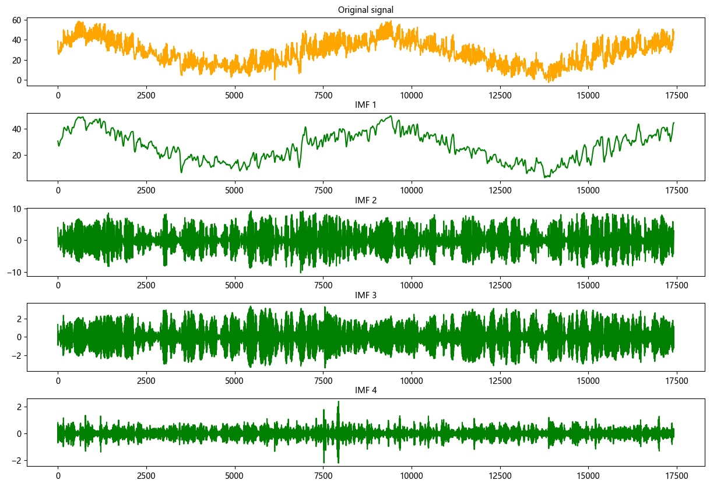
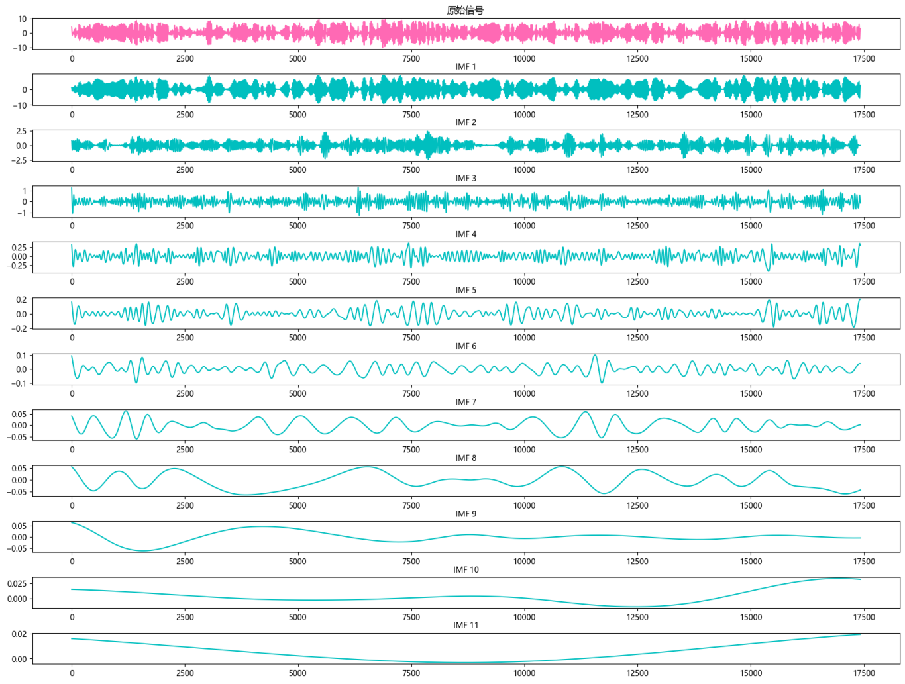
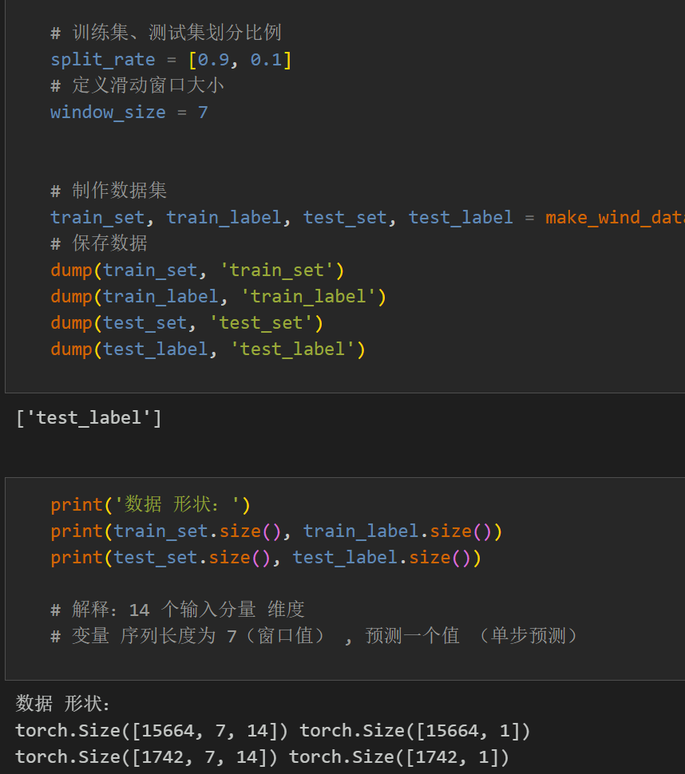
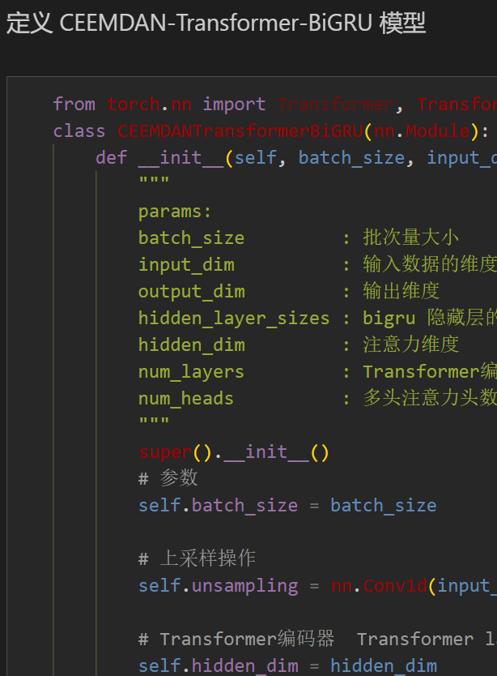
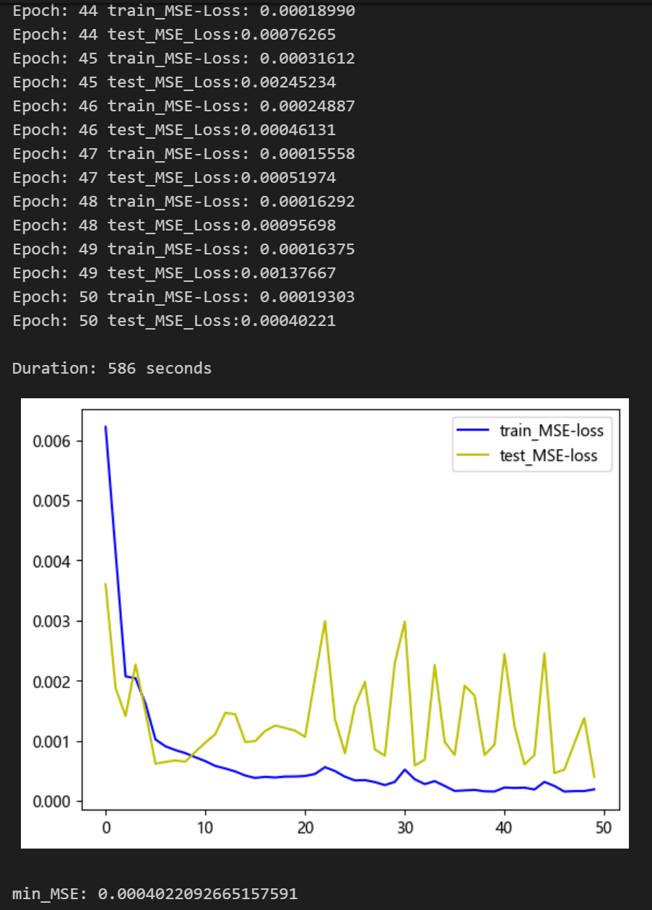
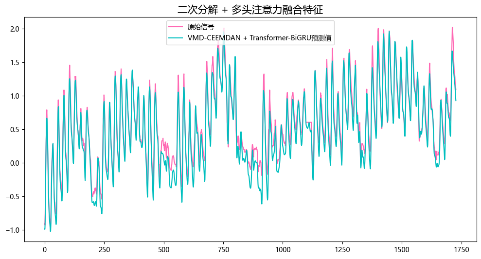
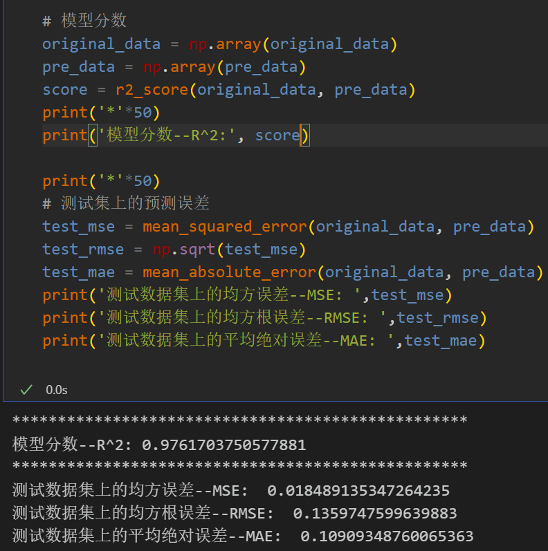
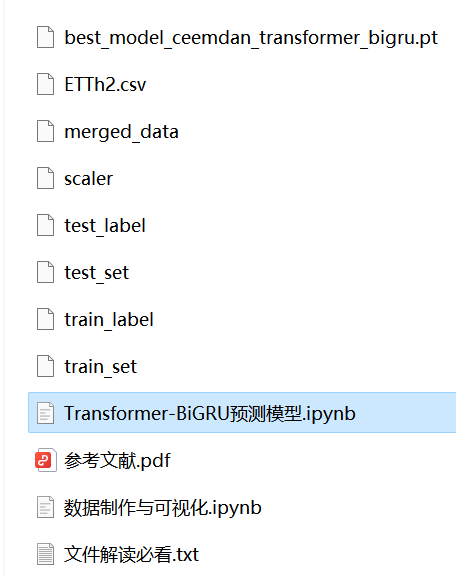

# VMD+CEEMDAN Secondary Decomposition, Transformer-BiGRU Prediction Model

The innovation points are:
- The secondary decomposition + multi-head attention feature fusion includes power transformer data, as well as the already generated dataset and label set, all of which can be run.
- VMD + CEEMDAN secondary decomposition, Transformer-BiGRU prediction model, with smaller MSE and MAE, the effect is particularly obvious, and there is a significant improvement!
- Including data preprocessing code and secondary decomposition code, as well as complete Transformer = BiGRU model prediction code and visualization code.
Innovation point: Secondary decomposition + multi-head attention feature fusion.
Preface:
This article introduces a Transformer-BiGRU prediction model based on VMD+CEEMDAN secondary decomposition for time series data prediction, aiming to improve the predictive performance of time series data. The detailed introduction to the power transformer dataset can be found in the following text:
Power Transformer Dataset Introduction and Preprocessing
1. Secondary Decomposition and Data Set Production
- Import data
- VMD decomposition
- Step one, observe the center frequency under different K values conditions, select the K value; from K=4, it starts to appear similar modality frequencies after decomposition, so the number of modes K is selected as 4.
- Step two, decomposition visualization
- Sample entropy
- Sample entropy is a method used to measure the complexity of a sequence, which can evaluate its complexity by calculating uncertainty in the sequence. Higher sample entropy indicates greater complexity.
- Through calculating the sample entropy of four components decomposed by VMD, higher sample entropy has richer uncontrollable information, and further extracting effective information from the highest entropy value component of VMD, conduct CEEMDAN decomposition.
- Step three, CEEMDAN decomposition
- Re-decompose the highest entropy value component decomposed by VMD
- Step four, dataset production
\tFirst, merge the components of VMD and CEEMDAN decomposition, dividing the training set and test set according to a ratio of 9:1.
2. Transformer-BiGRU prediction model based on Pytorch
2.1 Define the Transformer-BiGRU prediction model
\tNote: The input wind speed data has a shape of [64, 7, 14], batch_size=64. The number 7 represents the sequence length (the values are taken from a sliding window), and the dimension 14 represents the dimensionality of the merged components.
\t  
2.2 Set parameters and train the model
50 epochs, MSE is 0.000402. The prediction performance of the Transformer-BiGRU model with VMD+CEEMDAN secondary decomposition is good. After secondary decomposition, more information can be extracted from the sequence. The Transformer-BiGRU model can extract the spatiotemporal information of the component features, and the prediction effect is significantly improved. With appropriate adjustment of model parameters, further improvement in model prediction performance can be achieved.
\tNote: Adjust parameters.
\tThe number of layers in the BiGRU can be modified, as well as the dimensions per layer.
Adjust the number of Transformer encoder layers and attention dimensions, as well as the number of multi-head attention heads, to increase more epochs (be cautious to prevent overfitting).
\tThe sliding window length can be changed (set the appropriate window length).
3. Model Evaluation and Visualization
3.1 Results Visualization
3.2 Model Evaluation
Previously Featured Content:
Time Series Forecasting: Analysis and comparison of LSTM, ARIMA, Holt-Winters, SARIMA models
Wind Speed Prediction (Part 1) Data Set Introduction and Preprocessing
Wind Speed Prediction (II) EMD-LSTM Model Based on Pytorch
Wind Speed Prediction (III) EMD-LSTM-Attention Model
Wind Speed Prediction (IV) - EMD-Transformer Model Based on PyTorch
Wind Speed Prediction (V) - EMD-CNN-LSTM Model Based on PyTorch
Wind Speed Prediction (VI) - EMD-CNN-GRU Parallel Model Based on PyTorch
Wind Speed Prediction (VII) - VMD-CNN-BiLSTM Predictive Model
CEEMDAN + Combination Predictive Model (BiLSTM-Attention + ARIMA)
CEEMDAN + Combination Predictive Model (CNN-LSTM + ARIMA)
CEEMDAN + Combination Predictive Model (Transformer - BiLSTM + ARIMA)
CEEMDAN + Combination Predictive Model (CNN-Transformer + ARIMA)
Multi-Feature Variable Sequence Prediction (I) - CNN-LSTM Wind Speed Predictive Model
Multi-Feature Variable Sequence Prediction (II) - CNN-LSTM-Attention Wind Speed Predictive Model
Multi-Feature Variable Sequence Prediction (III) - CNN-Transformer Wind Speed Predictive Model
Multi-Feature Variable Sequence Prediction (IV) - Transformer-BiLSTM Wind Speed Predictive Model
Multi-Feature Variable Sequence Prediction (V) - CEEMDAN+CNN-LSTM Wind Speed Predictive Model
Multi-Feature Variable Sequence Prediction (VI) - CEEMDAN+CNN-Transformer Wind Speed Predictive Model
Predictive Model Based on the Particle Swarm Optimization Algorithm SSA - CEEMDAN-BiLSTM-Attention
Predictive Model Based on the Particle Swarm Optimization Algorithm SSA - CEEMDAN-Transformer-BiGRU
Superior Predictive Model: Secondary Decomposition-Combination Prediction
Multi-Feature Variable Sequence Prediction (VII) - CEEMDAN+Transformer-BiLSTM Predictive Model
Multi-feature variable sequence prediction (8) CEEMDAN-SSA-BiLSTM prediction model based on the Sparrow Optimization Algorithm
Multi-feature variable sequence prediction (9) CEEMDAN-SSA-BiGRU-Attention prediction model based on the Sparrow Optimization Algorithm
Multi-feature variable sequence prediction (10) CEEMDAN-SSA-Transformer-BiLSTM prediction model based on the Sparrow Optimization Algorithm
VMD + CEEMDAN secondary decomposition, BiLSTM-Attention prediction model

## Images

<!-- PAYMENT_BLOCK -->

## Get this dataset

- Payment link (Stripe): [Buy now](https://buy.stripe.com/3cs8yP7sY87d0vu9AB)
- Payment QR code: 

<!-- /PAYMENT_BLOCK -->
